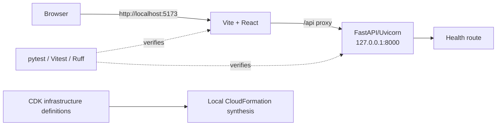
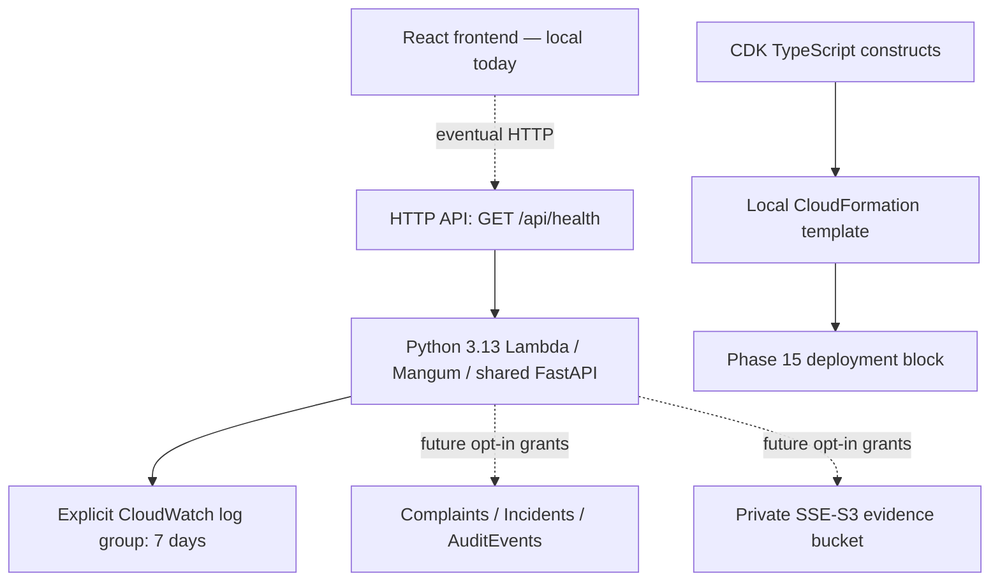
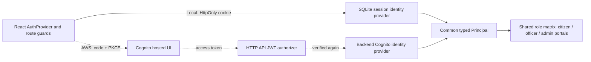

# CivicLens Architecture

## Phase 14 frontend architecture

`AuthProvider` and protected routes continue to enforce the existing session/role boundaries.
Public/authentication routes use `AppLayout`; authenticated administrator/officer/account routes
use the shared `AppShell`. Citizen routes retain `CitizenContext` and backend access verification
inside `DashboardLayout`, delegating presentation to the same shell. Shared CSS tokens/primitives
control layout and interactions. Heavy administrative route modules and map/chart renderers load
on demand; API service contracts, cursor pagination and evidence access remain unchanged.

Native modal dialogs handle mobile navigation and workflow confirmations. Local CSS motion has a
reduced-motion fallback. Actual records drive summaries/timelines; illustrations and optional
sample mode are explicitly separate. [Design system](FRONTEND_DESIGN_SYSTEM.md),
[verification](PHASE14_IMPLEMENTATION_REPORT.md).

The roadmap now reserves **Phase 15 — Final AWS Deployment**. Existing cloud safeguards remain;
no backend models, resource definitions or deployment commands were changed in Phase 14.

## Phase13 validation boundary

The local domain flow below is unchanged. Streamed request limits/security headers,
read-only diagnostics/backups and reproducible verification wrap it without adding
new domain services. Cloud source bindings/projection bootstrap, Linux packaging and
HTTPS hosting remain incomplete: [current readiness](PHASE13_READINESS_REPORT.md),
[adapter/resource inventory](AWS_DEPLOYMENT_READINESS.md). Offline synth is not a
successful deployment; the intentional deployment block remains.

## Phase12 advanced civic intelligence

Existing officer allocation → secure P4 evidence processor/storage → transactional repair attempt and
eligible citizen requests → private citizen responses → accountable ADMIN decision → P7 canonical
lifecycle + P8 aging invalidation + P9 review suspension + P10 SLA/outbox/notifications. Repair state is
a sidecar, not a conflicting incident-status authority. A failure before completion is rework/reopen,
not a synthetic new occurrence.

P10 final triage / ADMIN bounded check → historically verified repairs in indexed geographic envelope
→ reused P6 geography, TF-IDF and optional dHash → directional recurrence evidence → ADMIN identity
review. No automatic merge, hidden priority boost or calibrated-probability claim.

P11 consistent bounded source + P12 revision-fenced repair/recurrence facts → descriptive grid metrics,
other-cell comparisons, explicit denominators/missingness/minimum samples → private ADMIN map/table,
side-by-side comparison, versioned review notes and protected CSV. Cached derived responses expire
within30 seconds and invalidate immediately by source revision; workflow writes remain authoritative.
See REPAIR_VERIFICATION.md, RECURRENCE_DETECTION.md and GEOGRAPHIC_FAIRNESS.md for limitations.

## Phase11 private municipal analytics

Bounded source repositories → pure cohort/statistical/geographic calculations → typed analytics
API envelopes → protected React Command Center/detailed charts/tables/maps/reports. SQL reads share
one consistent source transaction; existing Phase8 scores, Phase9 workload and Phase10 targets are
authoritative. Analytics-owned revision/checkpoint/snapshot/export audit extensions do not change
operational records. Phase10 consumers observe events idempotently with isolated telemetry errors;
source changes invalidate revisions directly, so local metrics never depend on increment-only totals.
Cloud preparation reuses the existing operations table for bounded reconciled generation manifests,
not table scans or another event infrastructure. [Integration plan](PHASE_11_PLAN.md),
[source model](ANALYTICS_DATA_MODEL.md), [metric dictionary](MUNICIPAL_ANALYTICS.md).
Earlier phase inventories below are historical. No AWS deployment or Phase12 implementation.

## Phase10 current architecture

Transactional domain writes → private versioned event outbox → dispatcher → durable queue → idempotent
triage/priority/notification consumers. Existing Phase6–9 services remain authoritative. Persistent
execution/stage history, notification ownership, SLA breach receipts and bounded redrive are implemented.
Local SQLite schema8 is additive; existing worker owns a small event batch, not a second independent
matching algorithm. AWS preparation adds EventBridge/SQS/Standard Step Functions/SNS adapter and
one operations table. No live deployment or email delivery.
See [event architecture](EVENT_DRIVEN_ARCHITECTURE.md), [workflow graph](WORKFLOW_ORCHESTRATION.md)
and [failure recovery](FAILURE_RECOVERY.md). Historical sections below describe earlier phases.

## Phase9 work allocation (current)

Pure department routing and officer allocation/rebalancing policies consume existing canonical incident
and Phase8 priority inputs. WorkService exposes local/cloud repository boundaries; SQLiteWork implements
atomic versioned configuration, eligibility/capacity checks, receipts and append-only work history.
Schema7 sidecars reference existing IDs. Local routing runs as bounded work in the existing worker,
after matching, clustering and priority; no second daemon/orchestration system exists.

React department/assignment/officer portals use real authenticated APIs, explicit confirmations,
versioned retry-safe mutations and server keyset queues. Officer evidence authorization rechecks current
assignment and complaint membership. Citizen-safe DTOs/publication remain unchanged. Work progress does
not alter canonical OPEN status, severity, impact or aging. Manual approval is default.

DynamoWork prepares bounded strongly validated ledgers/manifests and conditional transactions on the
existing tables/indexes. P7/P8 transactions invalidate/refresh queue sidecars atomically. Cloud adapters
are SDK-mocked only, Lambda artifact remains source-only, and deployment is blocked until Phase15.
See [assignment design](ASSIGNMENT_DATA_MODEL.md) and [workflow states](WORKFLOW_STATES.md). Phase10
event-driven workflows, notifications and escalation are NOT STARTED.

## Current Phase 8 priority path

Existing canonical incident/members → one authoritative snapshot → validity/provisional assessment
rules → severity/impact/log-support/UTC-aging factors → versioned weighted rubric → separate verified
hazard/override policy → deterministic explanation → guarded result/control/receipt/history transaction
→ server-ranked fresh queue. Phase7 and eligibility/lifecycle hooks mark attached priorities dirty;
existing local worker or resumable CLI refreshes pending/hourly/expired/config-outdated inputs.
Scoring never modifies complaint content, memberships, duplicate scores or publication. Cloud helpers
are conditional/source-only with no scheduler or SDK call at import. [Design](PRIORITY_DATA_MODEL.md),
[policy](PRIORITY_SCORING.md), [actual evaluation](PRIORITY_EVALUATION.md).

## Current Phase 7 path

Complaint/evidence/outboxes commit → idempotent singleton → Phase6 matching → full-member cluster
validation → REVIEW_ONLY recommendations (or explicit experimental singleton auto-link).
ADMIN corrections atomically persist membership/counts/versions/aliases/receipts/history. Membership
authority is complaints.incident_id, not a graph component or public publication ID. CPU worker remains
local-only. [Incident design](INCIDENT_DATA_MODEL.md) and [operations/privacy](INCIDENT_CLUSTERING.md)
supersede Phase6's historical no-assignment limitation below.

## Current Phase 6 matching path

Complaint transaction → durable local outbox → single bounded CPU worker → internal private indexed
retrieval → category/lifecycle/exact Haversine gates → fixed-corpus word/character TF-IDF + cached
private dHash → renormalized fusion/safety guards → atomic canonical-pair/job persistence → ADMIN-only
review API/UI. Failure after submission retains the complaint/photos and retriable work.

Pure algorithms accept typed records/configuration only. DuplicateDetectionService injects repository,
storage and execution; SQLite and lazy DynamoDB adapters implement persistence. No citizen duplicate
existence/other-owner descriptions are exposed. Pair-scoped ADMIN evidence access does not broaden
owner-only citizen image routes. No merges, incident assignment, priority or department updates occur.

Cloud source defines separate InternalGeography/MatchingWork GSIs and a transactional outbox. Lambda
does not host a daemon; SQS/EventBridge orchestration is deferred. Manual admin rechecks are bounded.
Automatic cloud execution and a verified Linux dependency artifact remain future deployment work.
See DUPLICATE_DETECTION.md and MATCHING_EVALUATION.md for exact rules and measured limitations.

## Current Phase 5 search/publication/discovery paths

Personal search uses verified CITIZEN → owner-scoped SearchFilters → SQLite indexed/FTS5 queries and keyset pagination, never first-page-only filtering. Summary performs actual owner aggregates and UTC daily submissions. Existing submission, idempotency, sanitation and private evidence remain intact.

Public discovery is separate: owner consent → ADMIN-reviewed summary/general coordinates → transactional publication/audit → published-only cell-indexed bounds/Haversine queries. Public UUIDs/fields are separate from private identity/evidence. Withdrawal removes public eligibility atomically. React reuses Leaflet, private cards, guards and the API client; Chart.js loads on demand for accessible analytics. AWS prepares a sparse public GSI and strong projection rechecks without Scan. Its capped owner-catalog search is demonstration-only, not production search scalability.

COMPLAINT_SEARCH.md, DASHBOARD_ANALYTICS.md, GEOGRAPHIC_DISCOVERY.md and PUBLICATION_AND_PRIVACY.md define current contracts/limits. Earlier snapshots below are historical wherever they conflict with this path. AWS remains blocked and uncontacted.

## Current Phase 4 complaint path

The existing React report/list/detail/dashboard screens use the Phase 2 authenticated API client → FastAPI citizen/ownership policy → ComplaintService/EvidenceService → shared SQLite repository and private filesystem storage. Source images are bounded/decoded/sanitized before persistence; metadata/idempotency/quota commit transactionally after evidence is saved. Definite failures clean only their staged keys; uncertain cloud commits retain private objects for reconciliation. GET images authenticates ownership before reading bytes. No public static evidence mount exists.

AWS mode prepares the same service contracts with lazy DynamoDB/S3 adapters. The existing Complaints table also holds non-indexed idempotency/rate/summary sentinel items; ByCitizen Query + BatchGet supports listing without Scan. Local mode cannot select cloud providers, and AWS cannot fall back to SQLite/filesystem. Five additional explicit JWT-protected API routes and minimal scoped IAM grants are synthesized only. No AWS call/deployment occurred. COMPLAINT_SYSTEM.md and EVIDENCE_STORAGE.md describe the operational contract, crash windows and limitations. Phase snapshots below describe earlier checkpoints and are superseded by this current path.

## Phase 0 system

The React application uses page components, shared layout and state components, typed API services, and router-owned navigation. Its only server interaction in Phase 0 is the health check.

The backend uses an application factory, validated configuration, route modules, response schemas, and empty package boundaries for future domain work. Uvicorn imports `app.main:app` locally. Mangum wraps that exact ASGI application for future Lambda use; there is no second backend implementation and importing the adapter makes no AWS calls.

## Local-to-cloud boundaries

Business rules will depend on ports (interfaces/protocols) rather than AWS SDK calls. Adapters will be chosen from validated environment configuration. Production configuration must fail closed: local authentication, local storage, and simulation adapters may never be selected implicitly in `production`.

| Capability | Local implementation | Future AWS implementation |
|---|---|---|
| API | FastAPI/Uvicorn | API Gateway/Lambda |
| Data persistence | Local test adapter | DynamoDB |
| Image storage | Local filesystem adapter | S3 |
| Authentication | Explicit development-only mock | Cognito |
| Queue processing | Local simulated queue | SQS |
| Event processing | Local event dispatcher | EventBridge |
| Workflow execution | Local workflow simulation | Step Functions |
| Notifications | Local mock notification service | SNS |

Phase 0 defines package boundaries and configuration safety but deliberately does not implement these adapters.

## Phase 1 AWS definitions

Everything on the AWS side is a local definition, not a deployed service. The health role can only write its own logs; it has no data/evidence permissions. Dotted data connections are planned capabilities. The stack is composed from separate database, storage, monitoring, Lambda, and API constructs. Configuration validates local/demo/production; local creates no cloud stack, and production never defaults to wildcard CORS. Tags identify project and stage.

DynamoDB has three provisioned Standard tables plus four narrowly scoped GSIs, totaling 7 RCU/7 WCU per stage. The bucket blocks all public access and denies insecure transport. Both data stores use RETAIN; production tables also use deletion protection. Lambda references table/bucket names through settings without contacting them. Phase 2 added Cognito authorization definitions for identity/profile/role endpoints; health remains public. No complaint or data-storage route is implemented.

The staged Lambda source lacks runtime dependencies and is labeled non-deployable. Local assertions and synthesis cannot establish Linux runtime or IAM behavior in AWS. [INFRASTRUCTURE.md](INFRASTRUCTURE.md) describes Linux packaging, readiness checks, and the hard deployment block. Cloud verification and manual deployment remain Phase 15.

## Planned complaint-processing pipeline

This diagram is a future design, not a Phase 0 implementation. Domain services will own matching, clustering, scoring, and workflow rules. HTTP routes, databases, queues, and AWS constructs will remain replaceable delivery/infrastructure concerns.

## Local simulation limitations

## Phase 2 identity architecture

Only the local path is exercised live in this phase. The Cognito path has local cryptographic/mocked tests and CDK definitions; no AWS deployment exists. Password/session storage belongs only to the local provider. Both modes share profile and role policy. API Gateway validation is supplemented by backend signature/claim and group validation, not trusted frontend headers. Local-password routes are absent in AWS mode. See AUTHENTICATION.md and COGNITO_SETUP.md.

## Phase 3 citizen interface

The citizen workspace shares the Phase 2 AuthProvider and backend role policy. Public/citizen layouts, reusable complaint components and typed service boundaries are documented in [FRONTEND_ARCHITECTURE.md](FRONTEND_ARCHITECTURE.md). Real authentication/profile requests remain separate from optional sample-only complaint/notification services. Normal account views are empty; no complaint backend, persistence or evidence upload is claimed. Lazy Leaflet views receive data through props and provide manual/list fallbacks, with opt-in third-party tiles/geolocation. No backend or AWS definitions changed in Phase 3.

## Deferred cloud validation

Local adapters cannot validate IAM permissions, managed-service quotas, concurrency, retry and dead-letter behavior, EventBridge delivery, Step Functions semantics, Cognito token behavior, S3 policies, regional availability, observability, or real cloud cost. These require targeted tests after an approved Phase 15 deployment.

