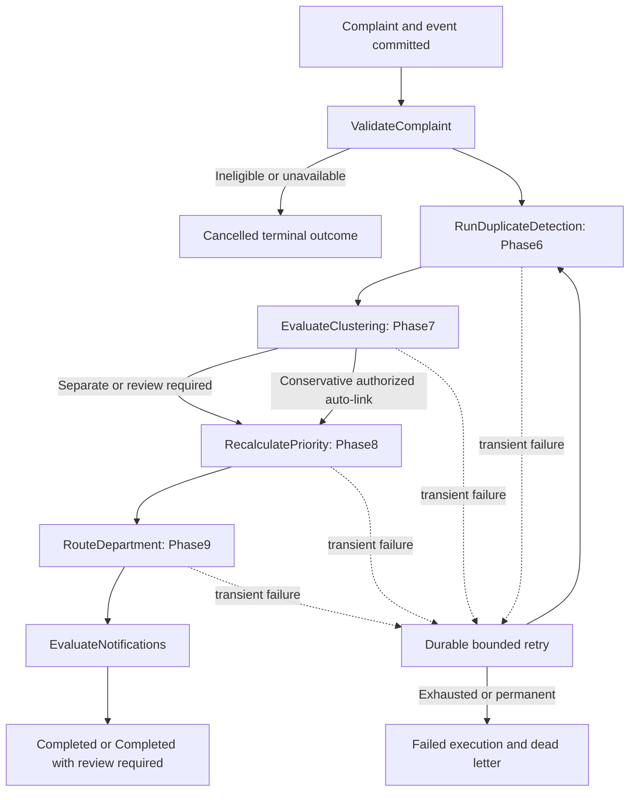

# Incident triage orchestration

Phase10 coordinates existing services, not new versions of their matching/scoring/routing algorithms.

The retry arrow represents re-entry at the first unfinished stage, not rerunning completed matching.
PENDING → RUNNING → WAITING_RETRY → RUNNING, or COMPLETED / COMPLETED_WITH_REVIEW_REQUIRED /
FAILED / CANCELLED. Each stage records RUNNING, COMPLETED or FAILED, bounded safe results, timestamp
and attempts. Completion requires all six required stages, unless ValidateComplaint establishes cancellation.
Interrupted RUNNING messages become claimable after their lease expires. A database workflow lease
prevents two different event IDs from executing one aggregate concurrently.

Phase6 COMPLETE/INCOMPLETE job results are reused. INCOMPLETE requires review; it is not silently
treated as a fully verified analysis. Phase7 review-only outcomes preserve separate incidents and never
wait for human approval. Priority resolves the current canonical incident and recalculates only stale inputs.
Routing retains existing departments/officers and explicit review locks, including blocked work. No
review-required outcome authorizes a merge, arbitrary priority override or final resolution.

## Local simulator
WorkflowService runs sequential persisted stages, catches failures and resumes idempotently. Test-only
fault injection is a Python attribute, never an HTTP input. Existing matching/clustering/priority/work
repositories remain responsible for their own atomicity. Normal submission succeeds before optional triage.
The simulator is not an ASL interpreter and does not emulate AWS scheduling, IAM, cold starts or service quotas.

## Standard Step Functions
CDK defines Initialize, the six named Lambda stages, eligibility/review choices, CompleteWorkflow,
RecordFailure, Succeed and Fail. Standard execution timeout5minutes; three bounded transient retries
with2-second exponential base. PermanentWorkflowError is caught without transient retries.
RecordFailure receives the safe error name, not a private exception payload. Catch failure still terminates.
Cloud queue leases600seconds exceed the bounded execution; STARTING fences the period between
durable enqueue and StartExecution so the recovery coordinator cannot race a normal new execution.
Execution names derive from event UUID/redrive generation; ExecutionAlreadyExists is handled as
accepted retry, not proof that business processing completed. Application receipts track completion.

The scheduled recovery port uses the same coordinator/services against DynamoDB, bounded to one
heavyweight recovered execution per invocation; normal multi-stage work uses Standard state transitions.
This is offline source/CDK preparation. Linux packaging, actual native dependencies/memory/timeouts,
Cognito synchronization and all live integrations require Phase14 verification.
